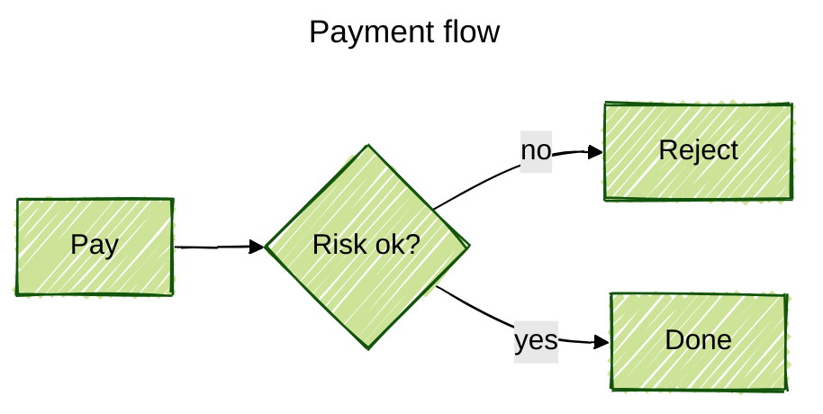

# Mermaid Standard

Bring **upstream mermaid** back to Obsidian. Since **Obsidian 1.15**, ```` ```mermaid ```` blocks are drawn by Obsidian's own engine (`lib/pele.min.js`, "Pele") instead of mermaid. Pele parses the syntax fine, but it drops the decoration layer — `theme`, `look` and `themeVariables` are silently ignored, so a note that asks for `theme: forest` and `look: handDrawn` renders in Obsidian's plain grey style.

This plugin hands rendering back to real mermaid, so those settings work again:



## How it works

Reading view and live preview both end up calling `pele.mount(el, source, opts)`. The plugin wraps `window.pele` (its exports are getter-only, so a `Object.create(pele)` wrapper is used instead of mutating) and replaces `mount` with a mermaid renderer that returns the same controller shape (`result / source / error / zoom / update / refresh / destroy`) and still calls `opts.onRender`, so Obsidian's link post-processing keeps working.

- One `mermaid.initialize()` per render: `theme` follows the app (`theme-dark` → `dark`), `fontFamily` follows `--font-mermaid`.
- Frontmatter `config:` and `%%{init}%%` directives still win over those defaults.
- `securityLevel: 'strict'`, `suppressErrorRendering: true` — syntax errors become a single red line instead of an injected error diagram.
- Bundled engine: mermaid 11.13.0 (~3.4 MB `main.js`).

## Compatibility

| | |
|---|---|
| Obsidian | 1.15.0+ (before 1.15 the app already used mermaid 11.13) |
| Mobile | untested — no Node APIs are used, so it should work |
| Diagram types | everything upstream mermaid 11.13 supports; `zenuml` is not supported |
| Other plugins | none required |

## Install

- **Community plugins**: browse for "Mermaid Standard" once it is listed.
- **BRAT**: add `dbtxdxy/obsidian-mermaid-standard`.
- **Manual**: copy `main.js`, `manifest.json` and `styles.css` into `<vault>/.obsidian/plugins/mermaid-standard/`, then enable it in Settings → Community plugins.

After enabling, scroll the open note or run the command **Re-render diagrams in current note**.

## Limitations

The plugin hooks `window.pele.mount`, an internal API. A future Obsidian release may change it — when that happens the hook quietly stops applying and you get stock Pele rendering back (no crash, no data loss).

## Development

```bash
npm install
npm run dev    # watch build
npm run build  # production build -> main.js
```

`npm version patch|minor|major` bumps `manifest.json` and `versions.json` via `version-bump.mjs`; the tag push triggers `.github/workflows/release.yml`, which builds and attaches `main.js`, `manifest.json` and `styles.css` to the GitHub release.

## 中文

Obsidian 1.15 起用自研的 Pele 引擎替换了 mermaid.js，`theme` / `look` / `themeVariables` 等标准 mermaid 配置不再生效。本插件接管 `pele.mount`，改回官方 mermaid 渲染，让这些配置恢复正常。安装后在「设置 → 第三方插件」里启用即可。

## License

MIT
